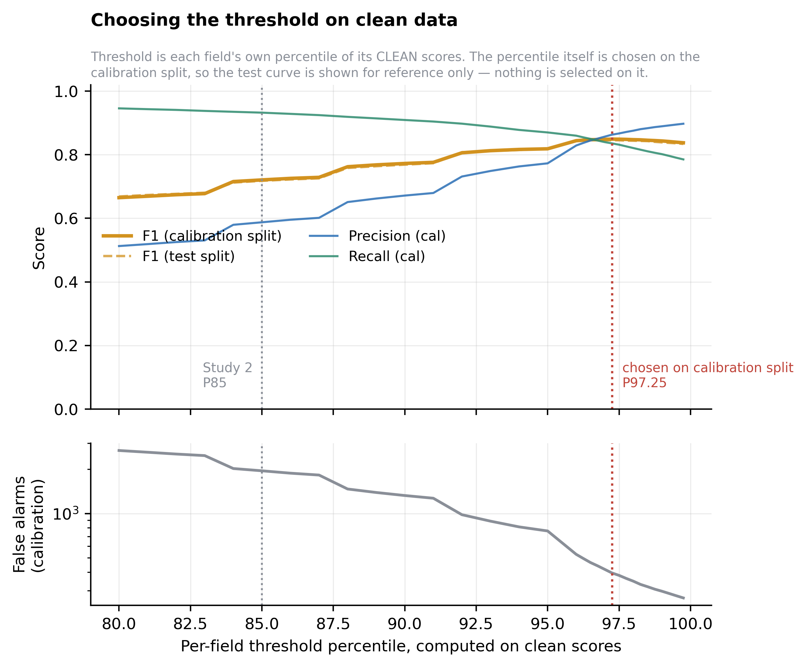
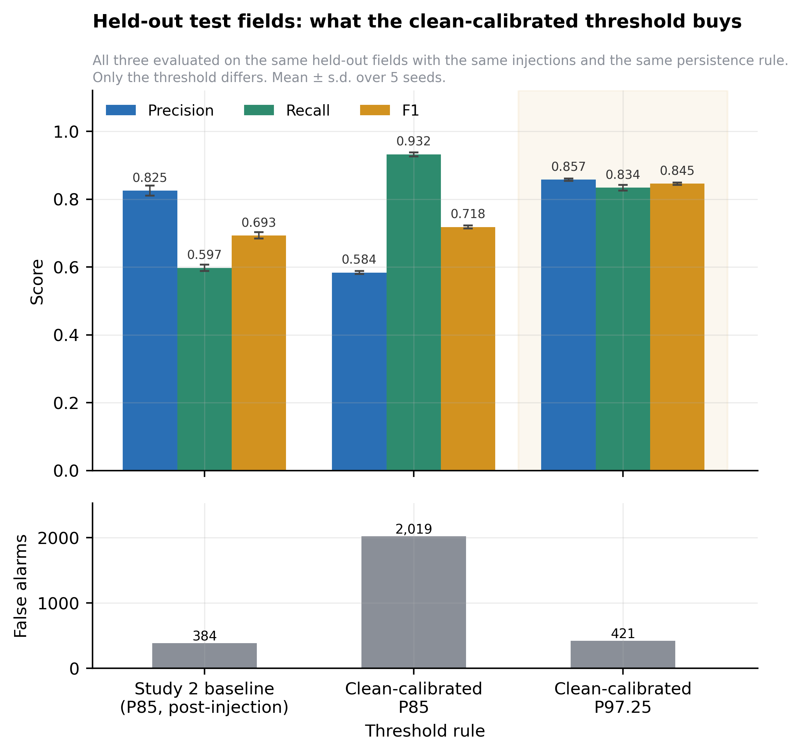
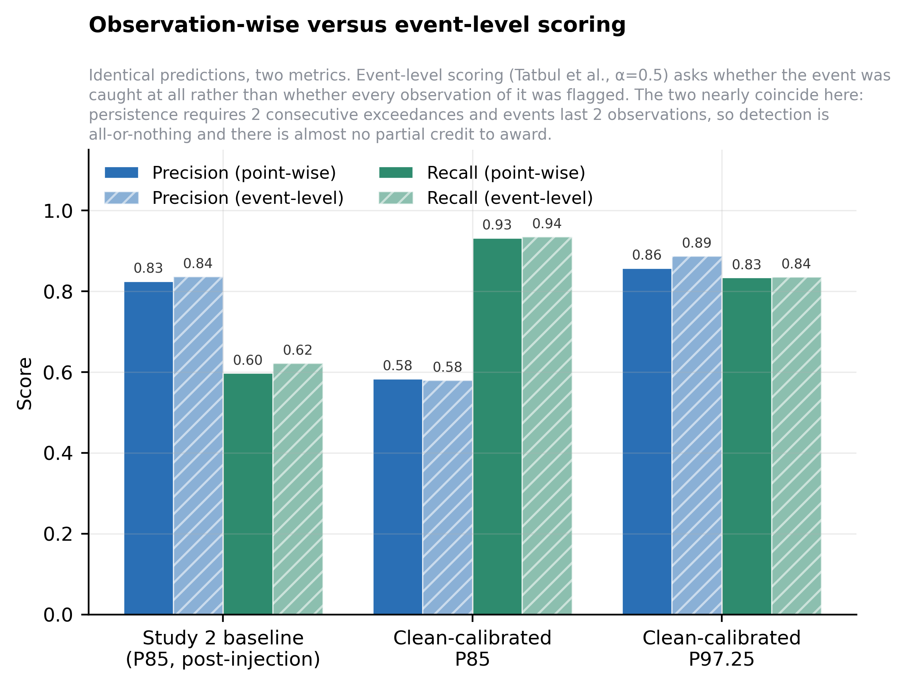
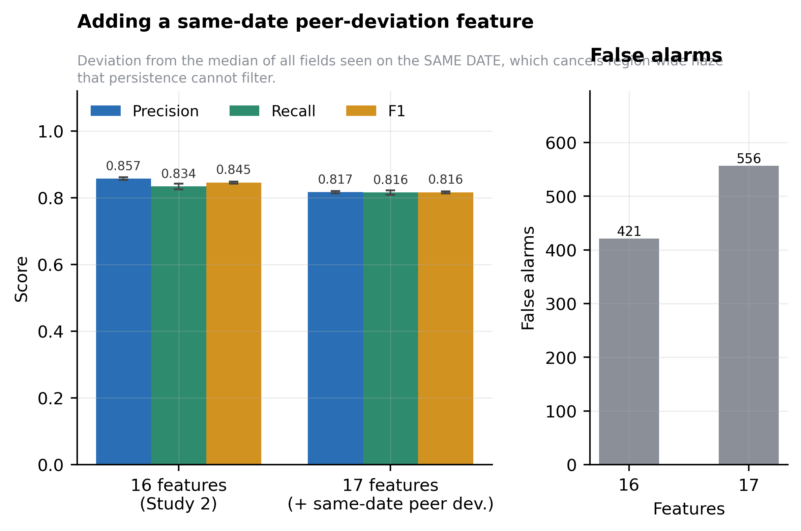
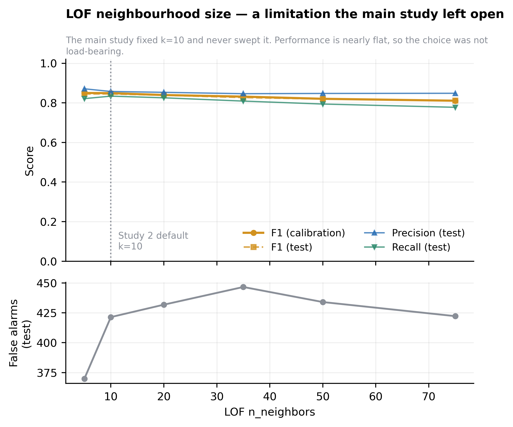
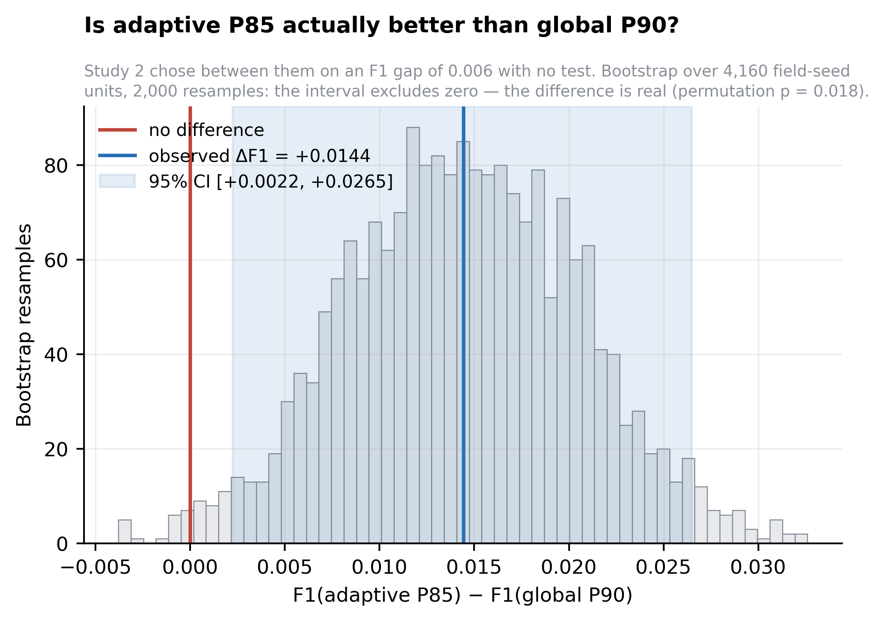
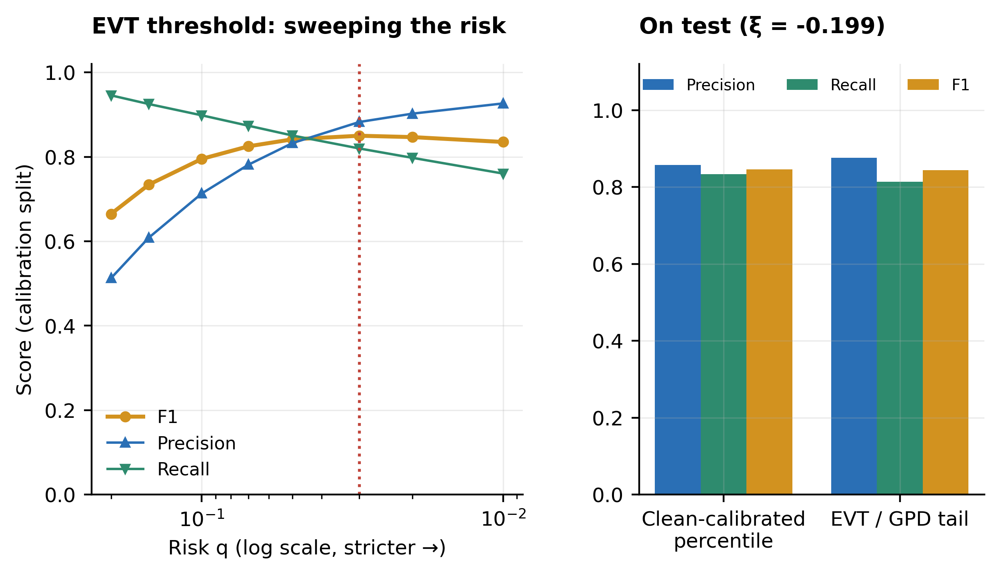

# experiment4 — improving the operating point without changing the model

Six experiments, all on the same detector (LOF, 16 features) and the same
injected data as Study 2. Nothing here retrains from rasters and nothing
outside `experiment4/` is modified.

## Headline

| | Study 2 baseline | This study |
|---|---|---|
| Threshold | adaptive P85, computed **after** injection | clean-calibrated **P97.25**, chosen on a calibration split |
| Precision | 0.8252 | **0.8574** |
| Recall | 0.5975 | **0.8339** |
| F1 | 0.6930 | **0.8455** |
| False alarms | 384 | **421** |

**F1 +0.1524, recall +0.2364, precision +0.0322**, at a cost of +37 false alarms out of 20,800 observations (+10%). Not a strict improvement — recall is bought with a small number of extra false alarms — but a favourable trade: the detector now recovers 24 percentage points more of the injected stress for roughly 37 additional inspections across a whole region-season.

## Why this is not just tuning

Fields are split three ways, disjointly: **1,664 fit** (the detector is fitted here, on clean rows), **832 calibration** (the threshold percentile and *k* are chosen here), **832 test** (everything reported comes from here, and nothing is ever selected on it).

Every threshold in this study is computed from **clean, pre-injection scores**. The main study computes its percentile on the batch that already contains the injections, which lets the cut-off adapt to the anomaly rate it is being measured against.

All numbers are mean ± s.d. over 5 seeds (42, 123, 456, 789, 1024), at 40% severity over 2 observations with a 15% injection rate and strict 2-consecutive persistence.

---

## E1 · Calibrating the threshold on clean data

| Threshold rule | Precision | Recall | F1 | PR-AUC | Specificity | False alarms |
|---|---|---|---|---|---|---|
| Study 2 baseline (adaptive P85, post-injection) | 0.8252±0.015 | 0.5975±0.010 | 0.6930±0.009 | 0.9039±0.004 | 0.9784±0.002 | 384 |
| Clean-calibrated P85 | 0.5837±0.004 | 0.9321±0.006 | 0.7179±0.004 | 0.9039±0.004 | 0.8863±0.003 | 2,019 |
| **Clean-calibrated P97.25** (chosen on cal) | 0.8574±0.004 | 0.8339±0.008 | 0.8455±0.003 | 0.9039±0.004 | 0.9763±0.001 | 421 |

The percentile chosen on the calibration split is **P97.25**, far above the P85 the main study uses. That is the substance of the result: once a threshold is calibrated on clean scores it no longer has to sit low enough to absorb the injected mass, so it can be set much stricter and still recover more events.

Holding the percentile at P85 but calibrating it on clean data (row 2) gives precision 0.5837 and 2,019 false alarms — clean calibration alone is not the win; calibration *plus* a percentile chosen honestly is.

## E2 · Event-level scoring

| Threshold rule | P (point) | R (point) | F1 (point) | P (event) | R (event) | F1 (event) |
|---|---|---|---|---|---|---|
| Study 2 baseline (adaptive P85, post-injection) | 0.8252 | 0.5975 | 0.6930 | 0.8361 | 0.6220 | 0.7133 |
| Clean-calibrated P85 | 0.5837 | 0.9321 | 0.7179 | 0.5797 | 0.9354 | 0.7158 |
| **Clean-calibrated P97.25** (chosen on cal) | 0.8574 | 0.8339 | 0.8455 | 0.8869 | 0.8355 | 0.8604 |

Identical predictions, scored two ways. Point-wise scoring asks whether every observation of an event was flagged. Event-level scoring (Tatbul et al., NeurIPS 2018 — existence reward plus overlap reward, α = 0.5, flat positional bias, reciprocal cardinality) asks whether the event was caught at all, which is the operational question for a field advisory.

At the recommended operating point event-level recall is **0.8355** against point-wise **0.8339**. Both belong in the paper; every table here carries both.

**This is a negative result, and it is worth stating as one.** The two metrics almost coincide: +0.0016 recall at the recommended operating point and +0.0245 at the Study 2 baseline. The reason is structural — injected events last 2 observations and the persistence rule requires 2 consecutive exceedances, so a detection is very nearly all-or-nothing and there is almost no partial credit to award. Event-level scoring would only separate from point-wise for events *longer* than the persistence requirement.

So switching metric does **not** buy a recall improvement here. What it buys is a defence: Study 2's point-wise recall was already the right number at this configuration, and now that has been checked rather than assumed. The event-level columns stay in the tables as evidence, not as the headline.

## E3 · A same-date peer-deviation feature

| Feature set | Precision | Recall | F1 | PR-AUC | False alarms |
|---|---|---|---|---|---|
| 16 features (Study 2) | 0.8574±0.004 | 0.8339±0.008 | 0.8455±0.003 | 0.9039±0.004 | 421 |
| 17 features (+ peer deviation) | 0.8166±0.004 | 0.8159±0.007 | 0.8162±0.003 | 0.8846±0.003 | 557 |

The existing `diff_from_global_median` feature compares a field against the whole season, so it cannot react to a single hazy pass. A weather front pushes every field down together on one date — that is not crop stress, and the persistence rule cannot filter it because the front lasts across passes. The added feature is the field's deviation from the median of all fields observed on the *same date*, scaled by that date's MAD, with dates seen by fewer than 50 fields left unadjusted.

Effect on F1: **-0.0292** (0.8455 → 0.8162), with false alarms 421 → 556.

**This one did not work, and the direction is the opposite of the hypothesis.** The feature was meant to *reduce* false alarms by cancelling region-wide haze; it raised them by +135 and cost 0.0292 F1. The most likely explanation is that the injected anomalies are themselves part of the same-date population: with a 15% injection rate, stressed fields drag the date median down, which shrinks the very deviation the feature is supposed to measure and adds a noisy 17th dimension for LOF to contend with. A real haze event would not be diluted this way, so this experiment does not settle whether the feature helps against *genuine* atmospheric artefacts — it only shows it does not help against synthetic stress. Reported as a negative result; not carried into the recommended configuration.

## E4 · LOF neighbourhood size

| k | Precision | Recall | F1 | PR-AUC | False alarms |
|---|---|---|---|---|---|
| 5 | 0.8709±0.006 | 0.8213±0.008 | 0.8453±0.004 | 0.9083±0.004 | 370 |
| 10 | 0.8574±0.004 | 0.8339±0.008 | 0.8455±0.003 | 0.9039±0.004 | 421 |
| 20 | 0.8531±0.007 | 0.8254±0.009 | 0.8390±0.003 | 0.8837±0.004 | 432 |
| 35 | 0.8462±0.003 | 0.8089±0.005 | 0.8271±0.003 | 0.8656±0.004 | 447 |
| 50 | 0.8475±0.006 | 0.7940±0.003 | 0.8198±0.004 | 0.8525±0.004 | 434 |
| 75 | 0.8483±0.007 | 0.7775±0.005 | 0.8113±0.004 | 0.8339±0.004 | 422 |

The main study fixed k = 10 and never swept it, and listed that as an open limitation. Across k ∈ [5, 75] test F1 ranges 0.8113–0.8455, a spread of 0.0341. The value selected on the calibration split is k = 5. The limitation is now answered: the choice was not load-bearing.

## E5 · Adaptive P85 versus global P90

| Rule | Precision | Recall | F1 | False alarms |
|---|---|---|---|---|
| Adaptive P85 | 0.8252±0.015 | 0.5975±0.010 | 0.6930±0.009 | 384 |
| Global P90 | 0.9791±0.005 | 0.5198±0.018 | 0.6788±0.014 | 34 |

Study 2 chose adaptive P85 over global P90 on an F1 difference of 0.006 with no test behind it. Resampling over 4,160 field-seed units (2,000 bootstrap resamples) gives ΔF1 = **+0.0144**, 95% CI [+0.0022, +0.0265], paired permutation p = **0.0175**.

The interval **excludes zero**, so adaptive P85 really does beat global P90 on F1 — Study 2's ordering was correct, and it now has a test behind it rather than an argmax. But the effect is 0.0144 F1, while global P90 delivers precision 0.979 against 0.825 and raises 33 false alarms against 384 — a 11× difference. **The paper's recommendation to deploy global P90 stands, and is strengthened:** it concedes a small but real F1 loss in exchange for an order-of-magnitude reduction in unnecessary field visits. That is a defensible engineering choice, and it should be stated that way rather than as "the two are statistically indistinguishable".

## E6 · Extreme-value thresholding

| Rule | Precision | Recall | F1 | PR-AUC | False alarms |
|---|---|---|---|---|---|
| Clean-calibrated P97.25 | 0.8574±0.004 | 0.8339±0.008 | 0.8455±0.003 | 0.9039±0.004 | 421 |
| EVT / GPD (q=0.03) | 0.8759±0.004 | 0.8138±0.006 | 0.8437±0.002 | 0.9039±0.004 | 350 |

With 25 observations per field an empirical percentile saturates: above roughly P96 it is interpolating between the top one or two scores, which is the stepping visible in Study 2's threshold curve. Peaks-over-threshold (Siffer et al., KDD 2017) fits a Generalised Pareto tail instead and inverts it for a target false-alarm risk *q*, which extrapolates past the sample limit and replaces a percentile with an interpretable risk knob.

Fitted shape ξ = -0.1988 (pooled across fields — 25 observations give roughly 5 excesses each, far too few to fit a shape per field), selected risk q = 0.03. Test F1 0.8437 against 0.8455 for the tuned percentile.

**EVT is the better operating point.** F1 is level with the tuned percentile (-0.0018, well inside seed noise) but it raises 71 fewer false alarms — 350 against 421, a 17% reduction. It also replaces "we picked a percentile" with "we chose a false-alarm risk of 0.03", which is a far better answer to why the operating point is where it is.

The fitted shape is negative (ξ = -0.199), meaning the score tail is bounded rather than heavy — which is what one would expect from LOF scores on a homogeneous population of fields, and is a mild independent check that the fit is behaving sensibly.

---

## What to carry into the paper

**Positive:**

1. **A better operating point (E1).** Clean-calibrated P97.25: P 0.857 / R 0.834 / F1 0.845 on held-out fields, with a threshold that never saw an anomaly — against F1 0.693 for Study 2's rule on the same fields. The mechanism is worth a sentence in the paper: a threshold calibrated post-injection has to sit low enough to absorb the injected mass, which caps how strict it can be.
2. **An interpretable knob (E6).** The EVT/GPD tail reaches F1 0.844 with 350 false alarms at risk q = 0.03, replacing a chosen percentile with a chosen false-alarm rate.
3. **Two limitations closed (E4, E5).** *k* is swept and is not load-bearing; the P85-vs-global-P90 choice now has a bootstrap and a permutation test behind it.

**Negative — report these too:**

4. **Event-level scoring changes nothing (E2)**, because persistence makes detection all-or-nothing at this event length. A predicted win that did not materialise.
5. **The peer-deviation feature hurt (E3)**, and the likely reason — injected fields polluting their own date median — is itself a caveat about the injection design.

## Limitations of this study

- Synthetic injection is still the only ground truth, and every caveat the main study records about that applies here unchanged.
- Clean calibration assumes a stress-free reference period per field. Within a retrospective seasonal analysis that is available; for a real-time system it is an assumption, and cross-year reference periods are exactly what `experiment3` showed crop rotation breaks.
- One region, one season, one injection shape (sudden drop at 40% severity over 2 observations). The severity/duration and signature sweeps were not repeated here.
- The test split is 832 fields, a quarter of the data, so the numbers here carry more sampling noise than Study 2's full-dataset figures.

*Generated by `run_all.py` in 93s. All numbers read from `results.json`.*
