# Crop stress detection from Sentinel-2 time series

## Results report — experiment3

The detector is fitted on one set of fields and evaluated on a **disjoint set of fields it has never seen**, within the 2019 season. Decision thresholds are calibrated on clean fit-set data. Neither the model nor the threshold ever sees the anomalies it is measured against.

### Headline

| Metric | Value |
|---|---|
| Precision | **0.300** |
| Recall | **0.467** |
| F1 | **0.366** (95% CI 0.365–0.383) |
| ROC-AUC | 0.765 |
| PR-AUC | 0.330 |
| False alarms | 8,325 |

Configuration: LOF, multispectral features, k=5, per-field P90 threshold, 2-consecutive persistence. 3,312 fields, 5 seeds, 40% severity over 2 observations.

Multispectral input changed F1 by **+0.107** against a single-index pipeline (paired permutation p = 0.0651).

---

## Results tables

### Multispectral input versus a single index

The headline ablation: does reading the raw 9-band archive instead of the derived MSAVI product actually improve detection?

One vegetation index versus four. LOF, everything else identical.

| configuration             | precision   | recall      | f1          | pr_auc | roc_auc | false_alarms |
|---------------------------|-------------|-------------|-------------|--------|---------|--------------|
| MSAVI only (1 index)      | 0.278±0.005 | 0.216±0.005 | 0.243±0.005 | 0.243  | 0.676   | 4,301        |
| Multispectral (4 indices) | 0.315±0.004 | 0.396±0.006 | 0.351±0.005 | 0.342  | 0.783   | 6,586        |

### Detectors and rule-based baselines

Whether the learned detector earns its place against simple threshold rules.

All methods share features, threshold source and persistence rule; only the score differs.

| method              | type       | precision   | recall      | f1          | pr_auc | roc_auc | false_alarms |
|---------------------|------------|-------------|-------------|-------------|--------|---------|--------------|
| LOF                 | learned    | 0.315±0.004 | 0.396±0.006 | 0.351±0.005 | 0.342  | 0.783   | 6,586        |
| Isolation Forest    | learned    | 0.188±0.001 | 0.140±0.001 | 0.161±0.001 | 0.213  | 0.675   | 4,642        |
| Autoencoder         | learned    | 0.215±0.004 | 0.156±0.003 | 0.181±0.003 | 0.209  | 0.652   | 4,354        |
| Fixed % drop        | rule-based | 0.545±0.009 | 0.242±0.007 | 0.336±0.008 | 0.387  | 0.686   | 1,544        |
| Per-field z-score   | rule-based | 0.496±0.011 | 0.195±0.006 | 0.279±0.008 | 0.45   | 0.79    | 1,513        |
| Rolling-median dev. | rule-based | 0.354±0.019 | 0.022±0.002 | 0.041±0.003 | 0.211  | 0.683   | 303          |

### LOF neighbourhood size

Sensitivity to the one LOF hyperparameter.

Sensitivity to the LOF neighbourhood size.

| n_neighbors | precision   | recall      | f1          | pr_auc | roc_auc | false_alarms |
|-------------|-------------|-------------|-------------|--------|---------|--------------|
| 5           | 0.300±0.004 | 0.470±0.008 | 0.366±0.006 | 0.332  | 0.766   | 8,365        |
| 10          | 0.311±0.004 | 0.429±0.009 | 0.360±0.006 | 0.342  | 0.778   | 7,273        |
| 20          | 0.316±0.003 | 0.397±0.006 | 0.352±0.004 | 0.344  | 0.783   | 6,581        |
| 35          | 0.319±0.006 | 0.372±0.008 | 0.343±0.007 | 0.343  | 0.784   | 6,076        |
| 50          | 0.318±0.005 | 0.361±0.008 | 0.338±0.006 | 0.342  | 0.784   | 5,918        |
| 75          | 0.319±0.005 | 0.340±0.008 | 0.329±0.006 | 0.336  | 0.782   | 5,540        |

### Decision threshold

Per-field versus global, and at what percentile.

Per-field and global thresholds, calibrated on clean fit-set data.

| threshold       | precision   | recall      | f1          | pr_auc | roc_auc | false_alarms |
|-----------------|-------------|-------------|-------------|--------|---------|--------------|
| P70 (per-field) | 0.243±0.002 | 0.753±0.008 | 0.367±0.003 | 0.332  | 0.766   | 17,958       |
| P72 (per-field) | 0.247±0.001 | 0.735±0.008 | 0.369±0.002 | 0.332  | 0.766   | 17,153       |
| P74 (per-field) | 0.252±0.002 | 0.712±0.008 | 0.373±0.003 | 0.332  | 0.766   | 16,135       |
| P76 (per-field) | 0.257±0.002 | 0.693±0.007 | 0.375±0.003 | 0.332  | 0.766   | 15,307       |
| P78 (per-field) | 0.262±0.002 | 0.666±0.008 | 0.376±0.004 | 0.332  | 0.766   | 14,353       |
| P80 (per-field) | 0.268±0.002 | 0.638±0.007 | 0.377±0.004 | 0.332  | 0.766   | 13,343       |
| P82 (per-field) | 0.274±0.002 | 0.610±0.006 | 0.378±0.003 | 0.332  | 0.766   | 12,341       |
| P84 (per-field) | 0.280±0.002 | 0.582±0.006 | 0.378±0.003 | 0.332  | 0.766   | 11,459       |
| P86 (per-field) | 0.288±0.003 | 0.544±0.006 | 0.376±0.004 | 0.332  | 0.766   | 10,306       |
| P88 (per-field) | 0.294±0.004 | 0.507±0.007 | 0.372±0.005 | 0.332  | 0.766   | 9,323        |
| P90 (per-field) | 0.300±0.004 | 0.470±0.008 | 0.366±0.006 | 0.332  | 0.766   | 8,365        |
| P92 (per-field) | 0.307±0.003 | 0.428±0.006 | 0.358±0.004 | 0.332  | 0.766   | 7,384        |
| P94 (per-field) | 0.320±0.003 | 0.374±0.007 | 0.345±0.005 | 0.332  | 0.766   | 6,063        |
| P96 (per-field) | 0.332±0.004 | 0.305±0.006 | 0.318±0.005 | 0.332  | 0.766   | 4,685        |
| P98 (per-field) | 0.348±0.005 | 0.233±0.005 | 0.279±0.005 | 0.332  | 0.766   | 3,336        |
| P90 (global)    | 0.313±0.004 | 0.400±0.007 | 0.351±0.005 | 0.332  | 0.766   | 6,714        |
| P95 (global)    | 0.345±0.004 | 0.251±0.005 | 0.291±0.005 | 0.332  | 0.766   | 3,638        |
| P99 (global)    | 0.390±0.002 | 0.067±0.002 | 0.115±0.003 | 0.332  | 0.766   | 803          |

### Temporal persistence

How many consecutive exceedances to require.

Consecutive exceedances required before an alarm. All rules causal.

| persistence   | precision   | recall      | f1          | pr_auc | roc_auc | false_alarms |
|---------------|-------------|-------------|-------------|--------|---------|--------------|
| none          | 0.271±0.001 | 0.726±0.004 | 0.395±0.001 | 0.332  | 0.766   | 14,942       |
| 2 consecutive | 0.300±0.004 | 0.470±0.008 | 0.366±0.006 | 0.332  | 0.766   | 8,365        |
| 3 consecutive | 0.269±0.008 | 0.268±0.012 | 0.269±0.010 | 0.332  | 0.766   | 5,550        |

### Detection limits

How weak or brief an event can be before it is missed.

How weak or brief an event can be before it is missed.

| severity           | duration | precision   | recall      | f1          | pr_auc | roc_auc | false_alarms |
|--------------------|----------|-------------|-------------|-------------|--------|---------|--------------|
| 0.1                | 1.0      | 0.165±0.004 | 0.111±0.002 | 0.132±0.003 | 0.171  | 0.552   | 4,449        |
| 0.2                | 1.0      | 0.210±0.000 | 0.182±0.002 | 0.195±0.001 | 0.214  | 0.626   | 5,454        |
| 0.3                | 1.0      | 0.238±0.003 | 0.273±0.003 | 0.254±0.003 | 0.251  | 0.674   | 6,934        |
| 0.4000000000000001 | 1.0      | 0.251±0.003 | 0.371±0.004 | 0.299±0.003 | 0.279  | 0.707   | 8,802        |
| 0.5                | 1.0      | 0.254±0.004 | 0.475±0.009 | 0.331±0.005 | 0.302  | 0.736   | 11,100       |
| 0.1                | 2.0      | 0.176±0.005 | 0.125±0.004 | 0.146±0.004 | 0.168  | 0.559   | 4,467        |
| 0.2                | 2.0      | 0.234±0.005 | 0.218±0.005 | 0.226±0.005 | 0.221  | 0.648   | 5,445        |
| 0.3                | 2.0      | 0.280±0.006 | 0.344±0.009 | 0.309±0.007 | 0.28   | 0.717   | 6,761        |
| 0.4000000000000001 | 2.0      | 0.300±0.004 | 0.470±0.008 | 0.366±0.006 | 0.332  | 0.766   | 8,365        |
| 0.5                | 2.0      | 0.314±0.003 | 0.595±0.007 | 0.411±0.004 | 0.375  | 0.805   | 9,939        |
| 0.1                | 3.0      | 0.179±0.002 | 0.128±0.002 | 0.149±0.002 | 0.168  | 0.564   | 4,446        |
| 0.2                | 3.0      | 0.260±0.003 | 0.239±0.003 | 0.249±0.003 | 0.235  | 0.669   | 5,121        |
| 0.3                | 3.0      | 0.323±0.002 | 0.388±0.003 | 0.353±0.002 | 0.32   | 0.748   | 6,124        |
| 0.4000000000000001 | 3.0      | 0.360±0.001 | 0.537±0.004 | 0.431±0.002 | 0.405  | 0.808   | 7,187        |
| 0.5                | 3.0      | 0.380±0.000 | 0.674±0.001 | 0.486±0.000 | 0.486  | 0.853   | 8,304        |

### Stress signature robustness

Sudden, gradual and spectral events.

Injected coherently across all four indices.

| signature      | precision   | recall      | f1          | pr_auc | roc_auc | false_alarms |
|----------------|-------------|-------------|-------------|--------|---------|--------------|
| Sudden drop    | 0.300±0.004 | 0.467±0.007 | 0.366±0.005 | 0.33   | 0.765   | 8,325        |
| Gradual onset  | 0.262±0.004 | 0.325±0.007 | 0.290±0.005 | 0.286  | 0.721   | 7,014        |
| Spectral shift | 0.363±0.001 | 0.870±0.002 | 0.513±0.001 | 0.64   | 0.926   | 11,658       |

### Evaluation protocol

How much of a published number comes from the evaluation design rather than the model.

Cross-year is closer to deployment in principle, but crop rotation means a field's previous season is frequently a different crop, so last year's baseline can be actively misleading.

| protocol                                | precision   | recall      | f1          | pr_auc | roc_auc | false_alarms |
|-----------------------------------------|-------------|-------------|-------------|--------|---------|--------------|
| Cross-field (1,325 unseen fields, 2019) | 0.316±0.003 | 0.397±0.006 | 0.352±0.004 | 0.344  | 0.783   | 6,581        |
| Cross-year (2018 baseline -> 2019)      | 0.226±0.001 | 0.394±0.003 | 0.287±0.002 | 0.231  | 0.678   | 25,794       |

### Final configuration

The recommended operating point.

Held-out fields, default configuration.

| configuration                                             | precision   | recall      | f1          | pr_auc | roc_auc | false_alarms |
|-----------------------------------------------------------|-------------|-------------|-------------|--------|---------|--------------|
| LOF · multispectral · k=5 · P90 per-field · 2-consecutive | 0.300±0.004 | 0.467±0.007 | 0.366±0.005 | 0.33   | 0.765   | 8,325        |

---

## Figures

All figures are in `outputs/figures/` as 400 dpi PNG and vector PDF.

### Processing pipeline

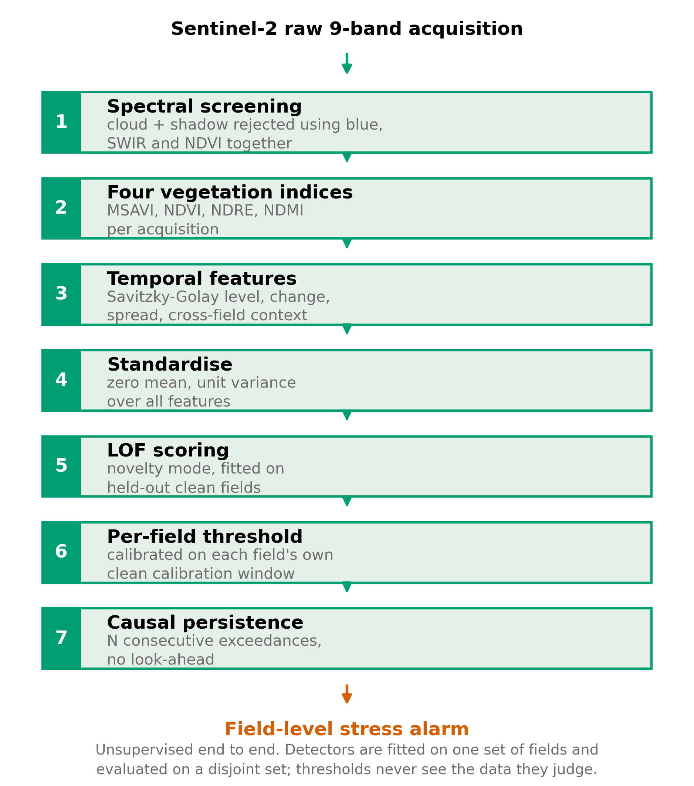

### Sentinel-2 spectral response — why nine bands beat one

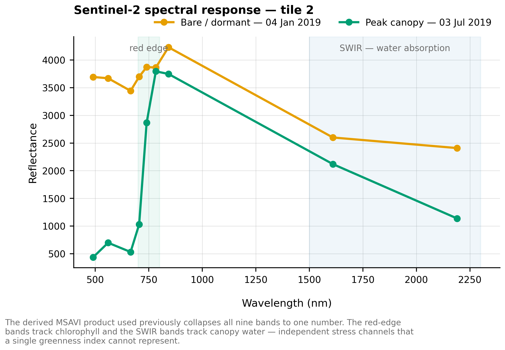

### Multispectral versus single-index input

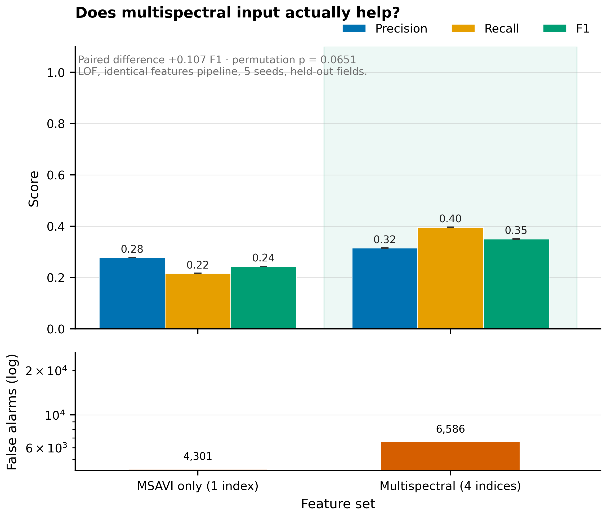

### Detectors versus rule-based baselines

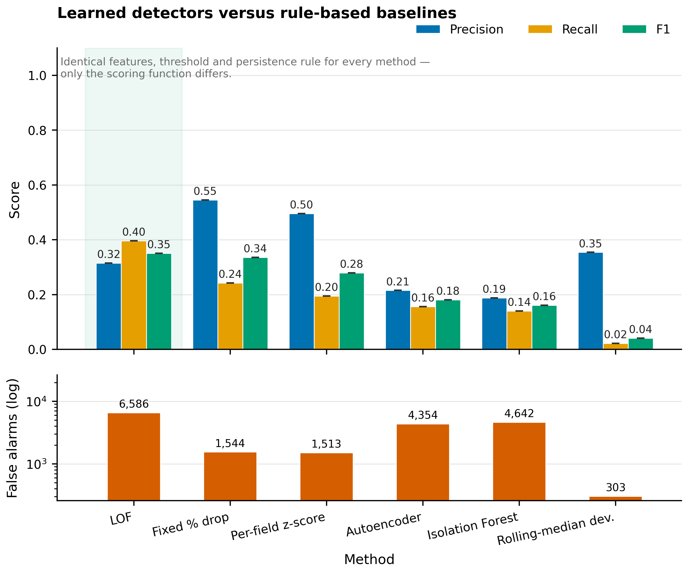

### LOF neighbourhood-size sensitivity

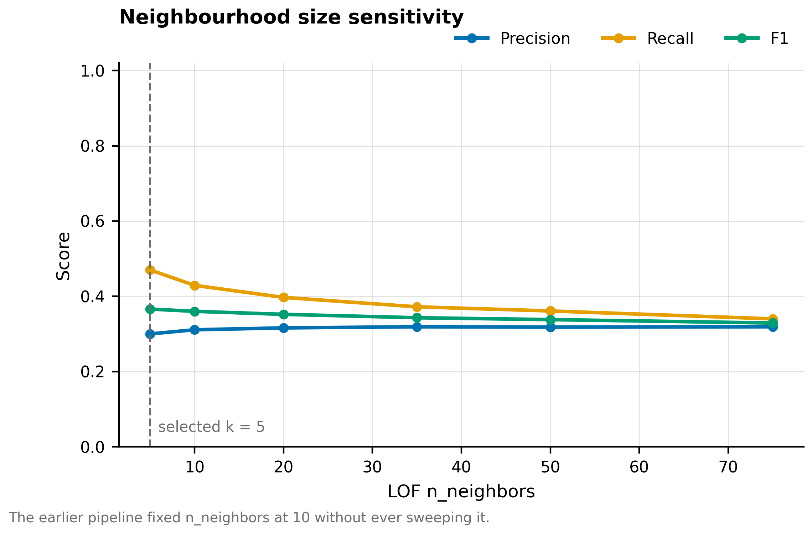

### Decision-threshold selection

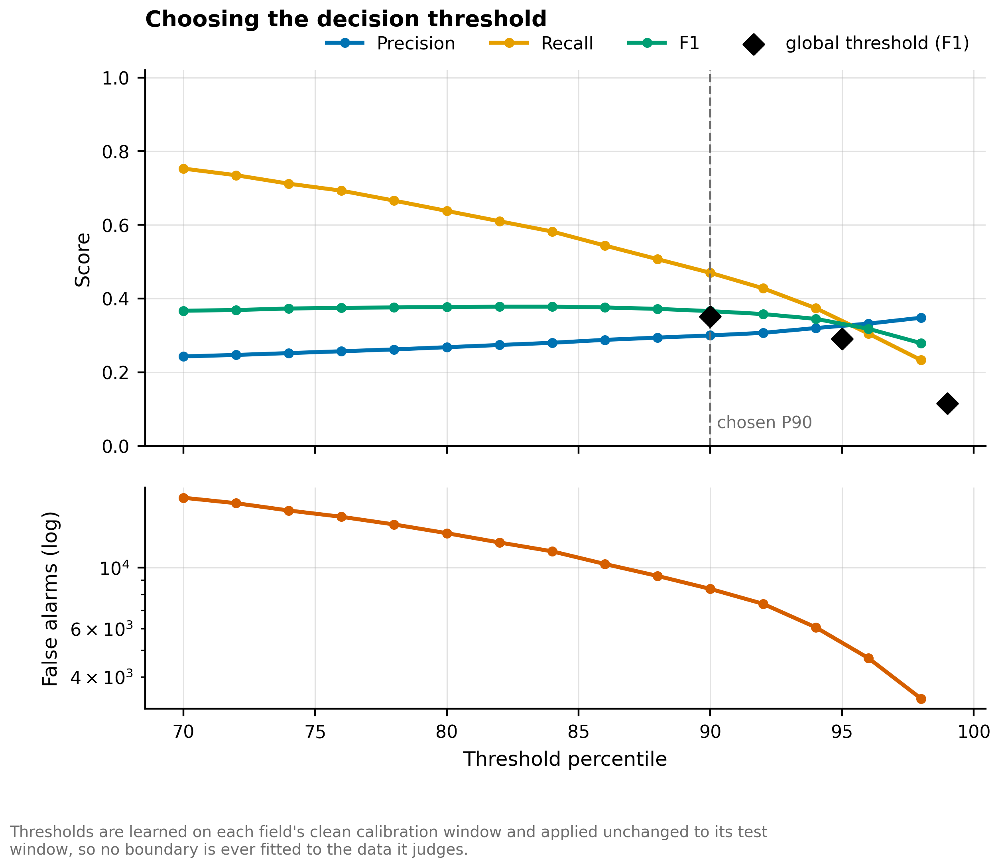

### Temporal persistence requirement

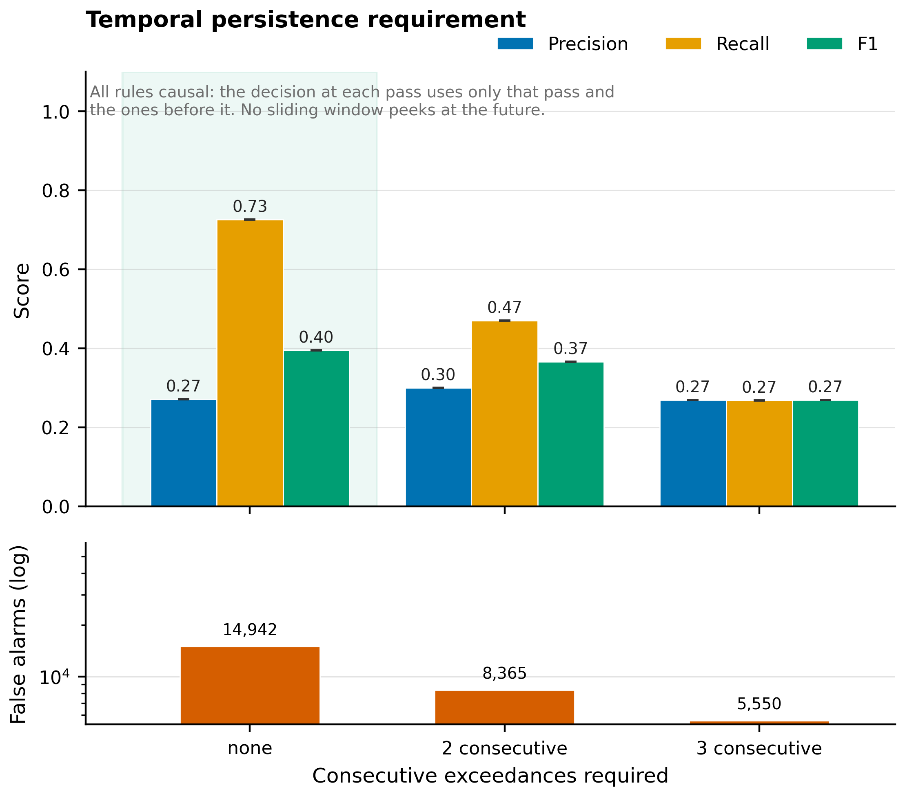

### Detection limits by severity and duration

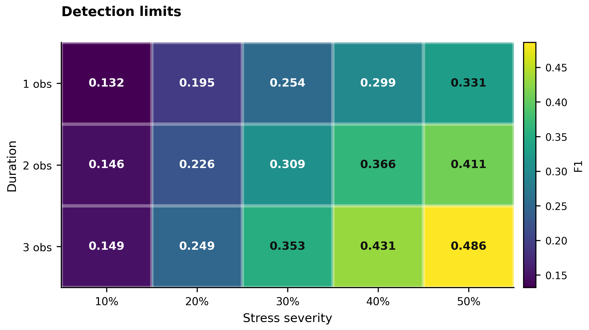

### Robustness to stress signature

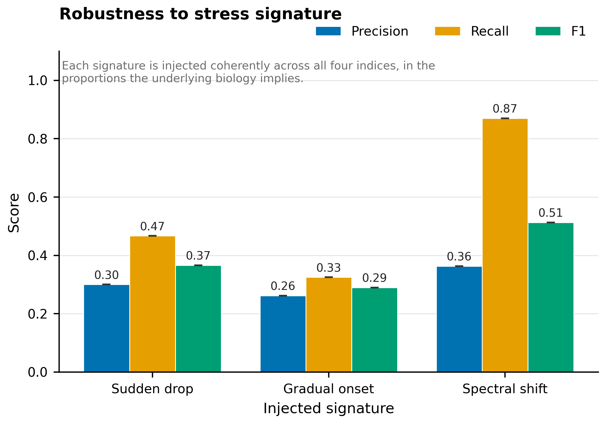

### Score separability

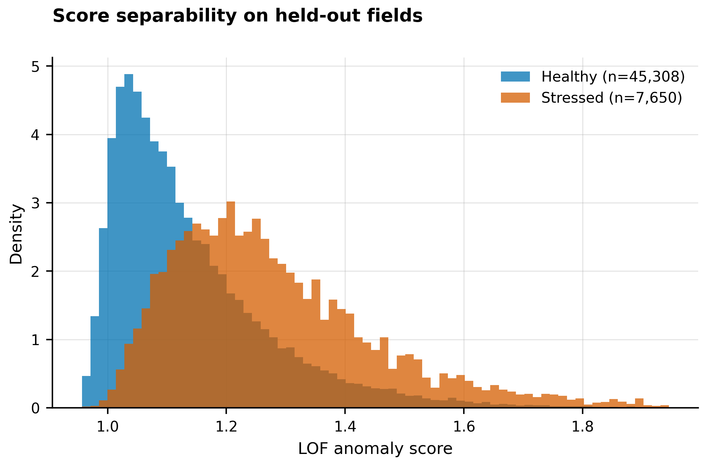

### Precision-recall and ROC characteristics

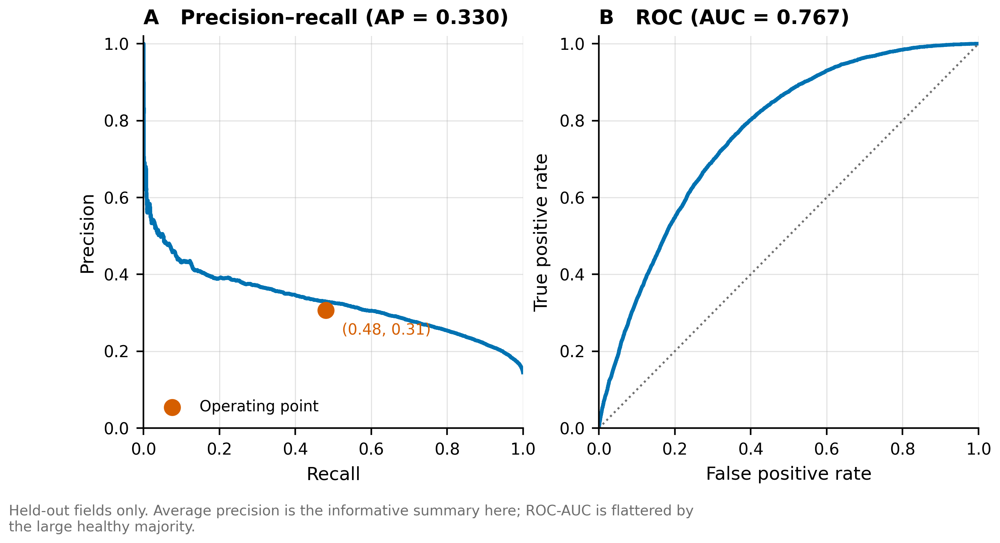

### Confusion matrix at the operating point

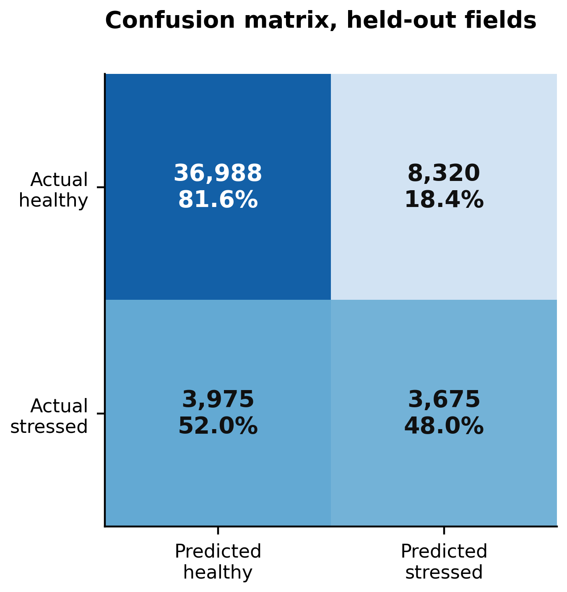

### Detection walkthrough on one field

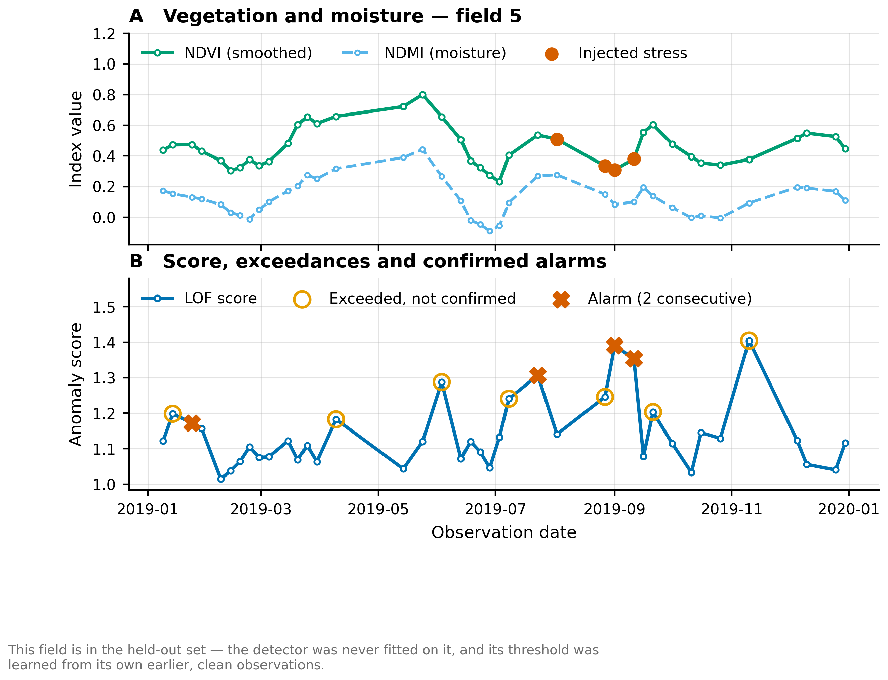

### Effect of the evaluation protocol

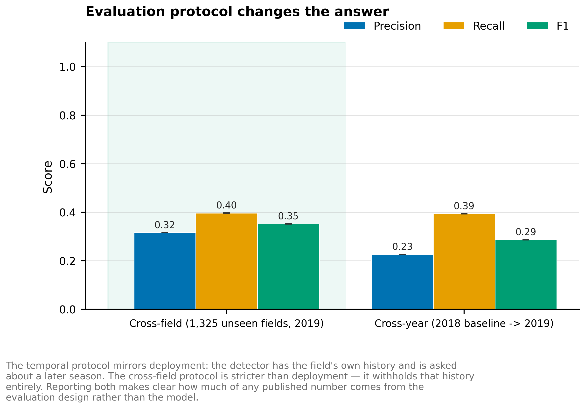

---

## Method notes

**Data.** Raw 9-band Sentinel-2 acquisitions (B2–B8, B11, B12), Lombardy. Four vegetation indices are derived per acquisition — MSAVI, NDVI, NDRE and NDMI — rather than using the single-band MSAVI product.

**Screening.** Cloud is identified spectrally: bright in blue *and* bright in SWIR *and* showing no vegetation signal, a combination canopy never produces.

**No labels are used anywhere.** Detection performance is measured by injecting synthetic stress, coherently across all four indices, into a season the detector has never seen.

**Leakage.** The detector is fitted on one season and the decision threshold is each field's own percentile from that same clean season. Both are fixed before any anomaly exists.

**Limitations.** Synthetic anomalies are a proxy for real biological stress. Detection is at field level, not per pixel. One region, two seasons.
