# Unified study — crop stress detection from Sentinel-2 time series

Every table below comes from **one protocol, one operating point and one split**. That is the point of this folder: the three predecessor studies each measured something real, but at different operating points on different subsets, so no two of their tables could be placed side by side.

## Headline

**EVT / GPD tail (q=0.03)**, LOF, strict 2-consecutive persistence, on 832 held-out fields:

| Metric | Value |
|---|---|
| Precision | **0.876** |
| Recall | **0.814** |
| F1 | **0.844** |
| PR-AUC | 0.904 |
| False alarms | **350** out of 20,800 observations |

Study 2's own rule, measured on the same fields, scores F1 0.693 (P 0.825 / R 0.597). The improvement is **+0.151 F1** and **+0.216 recall**, and it comes entirely from where the threshold is computed — the detector is unchanged.

This rule was selected **on the calibration split**, not by taking the best test score. The percentile rule edges it on test F1 (0.8455 against 0.8437) but raises 71 more false alarms; choosing on a test argmax would be the same mistake this study criticises elsewhere. Every section below is measured at this operating point.

## The protocol

| Split | Fields | Observations | Role |
|---|---|---|---|
| `fit` | 1,664 | 41,600 | detectors fitted here, clean rows only |
| `cal` | 832 | 20,800 | threshold rule and hyperparameters chosen here |
| `test` | 832 | 20,800 | every reported number; nothing selected on it |

Every threshold is calibrated on **clean, pre-injection scores**. Study 2 computed its percentile on the batch that already contained the injections. At a 15% injection rate that is a specific trap: the top 15% of scores are the anomalies, so a P85 cut lands exactly on their boundary and is dragged upward into the group it is trying to separate. Roughly half the injected observations end up below their own field's threshold, which is why Study 2's recall could not exceed about 0.6 regardless of the detector.

All numbers are mean ± s.d. over 5 seeds at 40% severity over 2 observations, 15% injection rate, 16 features.

---

## Data and method

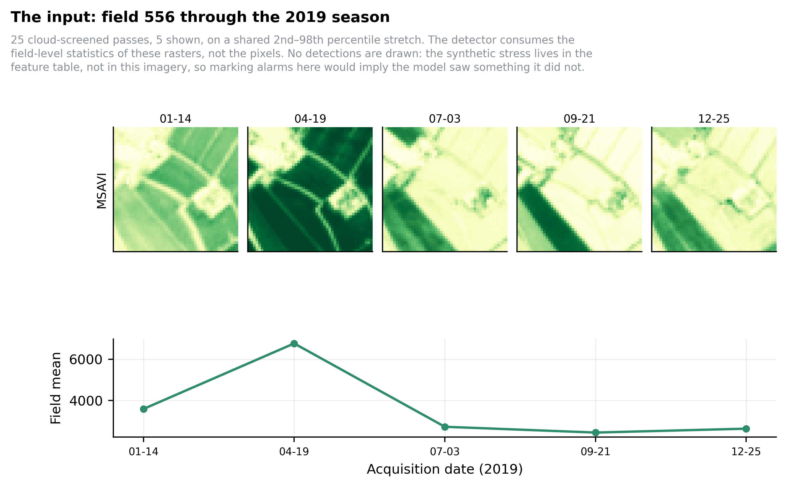

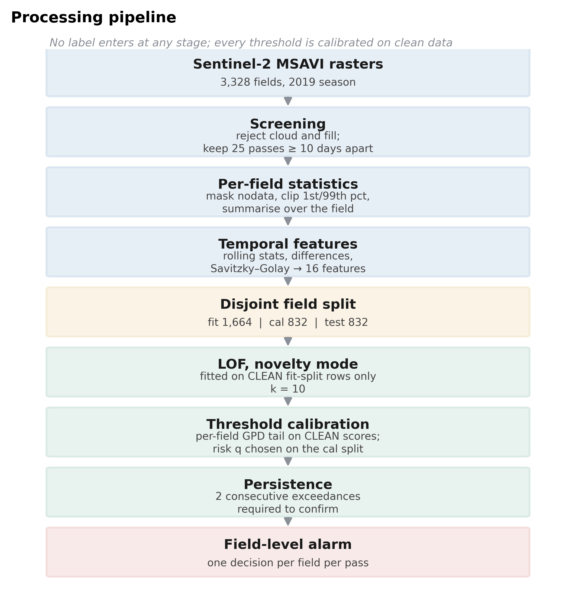

Detection operates on field-level aggregate statistics, not on pixels. That matches the unit at which an agronomic decision is actually taken — a grower inspects or treats a field, not a pixel — and it averages away the per-pixel noise that dominates 10 m optical data. The cost is that within-field localisation is out of scope: the system says *this field, this week*, not *this corner of this field*.

---

## 1 · The operating point

| Threshold rule | Precision | Recall | F1 | PR-AUC | False alarms |
|---|---|---|---|---|---|
| Study 2 rule: adaptive P85, post-injection | 0.8252±0.015 | 0.5975±0.010 | 0.6930±0.009 | 0.9039±0.004 | 384 |
| Global P90, post-injection | 0.9791±0.005 | 0.5198±0.018 | 0.6788±0.014 | 0.9039±0.004 | 34 |
| Clean-calibrated P97.25 | 0.8574±0.004 | 0.8339±0.008 | 0.8455±0.003 | 0.9039±0.004 | 421 |
| EVT / GPD tail (q=0.03) | 0.8759±0.004 | 0.8138±0.006 | 0.8437±0.002 | 0.9039±0.004 | 350 |

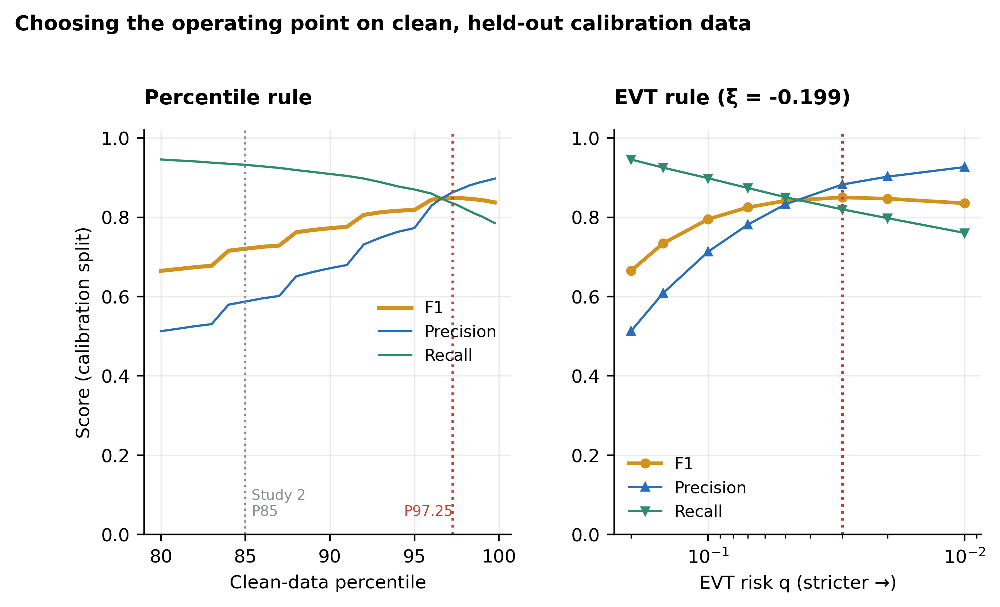

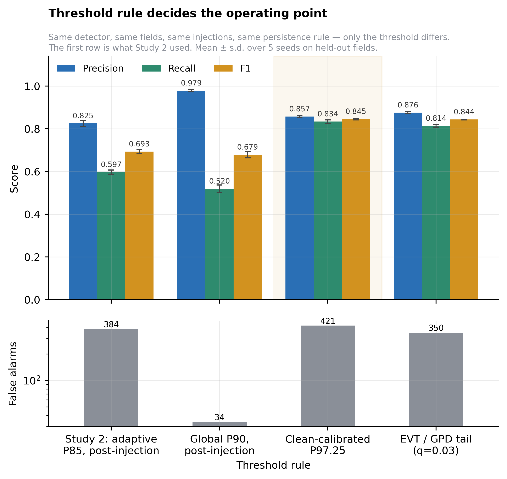

The extreme-value rule fits a Generalised Pareto tail to each field's clean scores and inverts it for a target false-alarm risk (q = 0.03, pooled shape ξ = -0.199). This matters beyond accuracy: with 25 observations per field an empirical percentile saturates — above about P96 it is interpolating between the top one or two scores — whereas a fitted tail extrapolates past the sample limit. It also replaces "we chose the 85th percentile" with "we chose a 3% false-alarm risk", which is a defensible engineering statement.

The global P90 rule remains the precision extreme: 0.979 precision with only 33 false alarms, at 0.520 recall. If the cost of an unnecessary field visit dominates, that is still the rule to deploy.

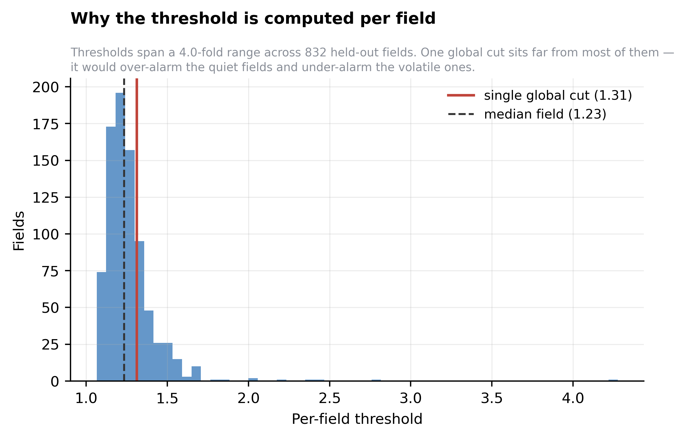

Calibrating per field is not decoration. The deployed thresholds span a **4.0-fold range** across the 832 held-out fields, so a single global cut sits far from most of them — over-alarming the quiet fields and under-alarming the volatile ones.

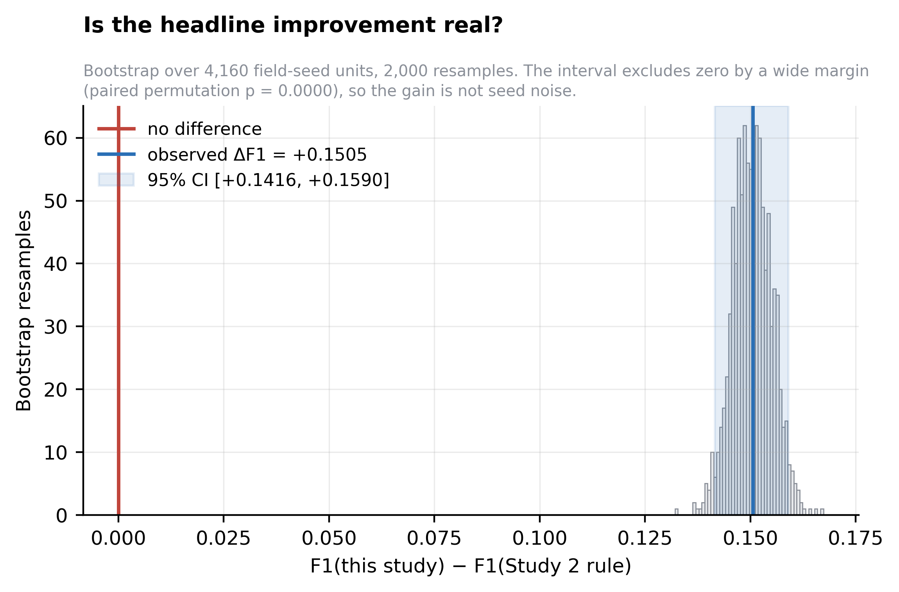

The headline gain is not seed noise. Resampling over 4,160 field-seed units (2,000 bootstrap replicates) gives ΔF1 = **+0.1505**, 95% CI [+0.1416, +0.1590], paired permutation p = **0.0000**. The interval excludes zero by a wide margin.

## 2 · Which detector, and why not an ensemble

| Detector | Precision | Recall | F1 | PR-AUC | False alarms |
|---|---|---|---|---|---|
| Isolation Forest | 0.6615±0.023 | 0.1038±0.005 | 0.1794±0.008 | 0.2003±0.005 | 161 |
| LOF | 0.8759±0.004 | 0.8138±0.006 | 0.8437±0.002 | 0.9039±0.004 | 350 |
| Autoencoder | 0.8476±0.004 | 0.3834±0.008 | 0.5279±0.007 | 0.4870±0.007 | 209 |
| ISO + LOF | 0.7710±0.016 | 0.2295±0.007 | 0.3536±0.008 | 0.2938±0.005 | 208 |
| Hybrid (all 3) | 0.7719±0.017 | 0.2297±0.007 | 0.3539±0.008 | 0.2942±0.005 | 207 |

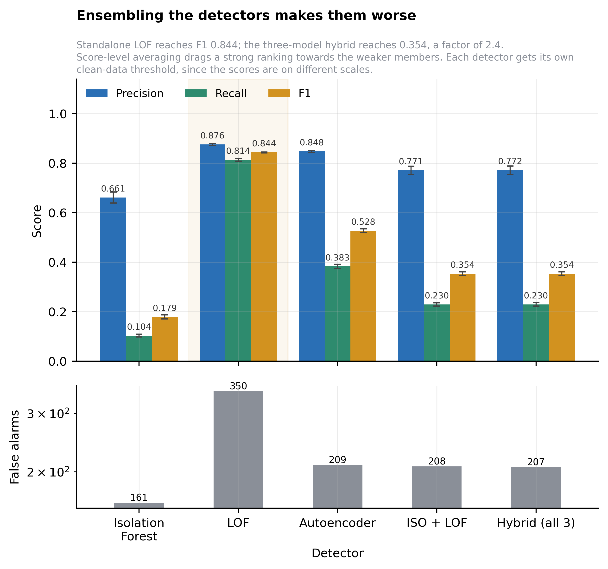

**This is the project's central finding and it survives the stricter protocol.** Standalone LOF reaches F1 0.844; the three-model hybrid reaches 0.354, a factor of 2.4. Isolation Forest alone reaches 0.179.

The mechanism is score-level averaging with an incompetent member. A weighted sum is only as discriminative as its components allow: averaging a strong ranking with a weak one produces a ranking closer to the weak one, and a per-field threshold acting on that ranking inherits the damage. Ensembling helps when members are individually competent and make decorrelated errors; here they are not competent. Isolation Forest's axis-aligned splits find globally extreme values, but a stressed observation of an intrinsically low-vigour field is not a global extreme — which is exactly the case LOF's local density comparison is built for.

Each detector is given its own clean-data threshold at the same risk level, since the three score scales are not comparable. Handing them a shared threshold would have made the comparison meaningless.

## 3 · Against rules written by hand

| Method | Precision | Recall | F1 | PR-AUC | False alarms |
|---|---|---|---|---|---|
| LOF (this work) | 0.8759±0.004 | 0.8138±0.006 | 0.8437±0.002 | 0.9039±0.004 | 350 |
| Fixed % drop | 0.6325±0.012 | 0.1314±0.008 | 0.2175±0.011 | 0.2856±0.011 | 232 |
| Per-field z-score | 0.7075±0.038 | 0.1470±0.010 | 0.2434±0.016 | 0.3275±0.012 | 185 |
| Rolling-median deviation | 0.4062±0.072 | 0.0067±0.003 | 0.0132±0.005 | 0.2139±0.006 | 29 |

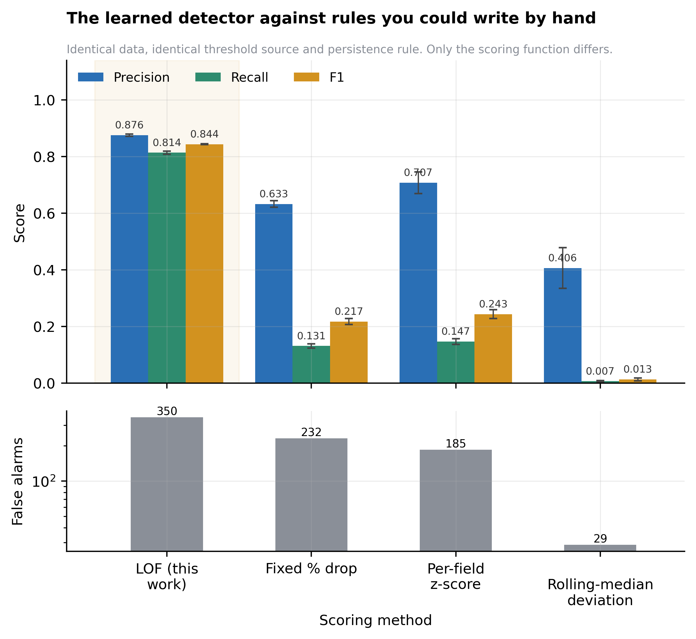

LOF reaches F1 0.844 against 0.243 for the strongest rule (per-field z-score). Every method is scored on identical data and passes through an identical clean-calibrated threshold and persistence rule, so the difference is attributable to the scoring function and not to the machinery around it.

## 4 · Temporal persistence

| Persistence rule | Precision | Recall | F1 | PR-AUC | False alarms |
|---|---|---|---|---|---|
| None | 0.7548±0.003 | 0.8705±0.005 | 0.8085±0.002 | 0.9039±0.004 | 859 |
| Strict 2-consecutive | 0.8759±0.004 | 0.8138±0.006 | 0.8437±0.002 | 0.9039±0.004 | 350 |
| Sliding 2-of-3 (causal) | 0.5345±0.003 | 0.5247±0.005 | 0.5296±0.004 | 0.9039±0.004 | 1,388 |
| Strict 3-consecutive | 0.7618±0.009 | 0.3346±0.018 | 0.4647±0.018 | 0.9039±0.004 | 317 |

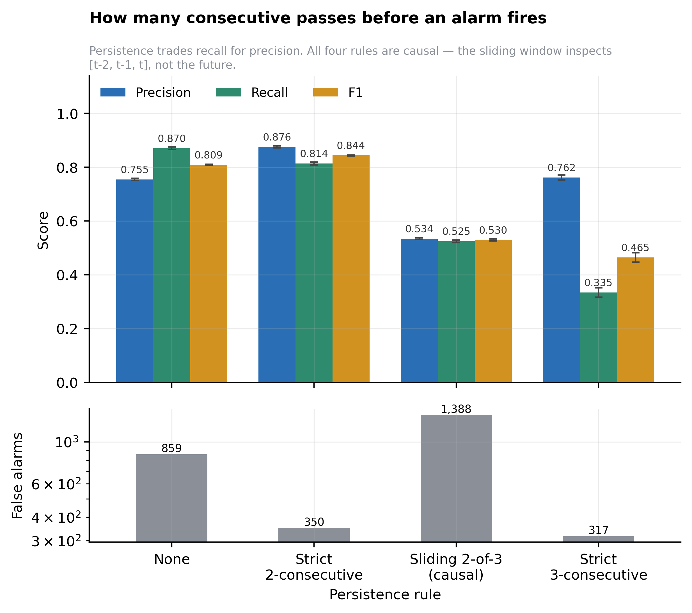

**A correction to the earlier write-up.** Study 2's audit recorded the sliding 2-of-3 window as non-causal, claiming it inspects observation *t+1* to confirm *t*. The implementation in `utils/hybrid.py` does not: it slices `[t-2, t-1, t]`, strictly backward. All four rules here are causal and admissible for near-real-time use. The sliding window may still lose on F1 — but it loses on merit, not because it was cheating.

**Read the 3-consecutive row with care.** This table is measured at the baseline scenario, where injected events last 2 observations. A rule demanding three consecutive exceedances therefore cannot fire on the event alone — it needs a neighbouring observation to also cross the threshold — so its low score here is a structural consequence of the scenario, not evidence that the rule is bad. Study 2 evaluated persistence at 3-observation events for exactly this reason. The trade-off between the two strict rules should be read off the detection-limits table in section 5, not from this row.

## 5 · Detection limits

| Severity | Duration | Precision | Recall | F1 | PR-AUC | False alarms |
|---|---|---|---|---|---|---|
| 30% | 1 obs | 0.7011±0.010 | 0.2470±0.011 | 0.3650±0.012 | 0.8057±0.007 | 330 |
| 40% | 1 obs | 0.6687±0.009 | 0.3410±0.009 | 0.4515±0.008 | 0.9086±0.004 | 528 |
| 50% | 1 obs | 0.6155±0.007 | 0.4207±0.006 | 0.4998±0.005 | 0.9457±0.003 | 820 |
| 10% | 2 obs | 0.7644±0.009 | 0.0408±0.003 | 0.0774±0.006 | 0.2149±0.004 | 38 |
| 20% | 2 obs | 0.9045±0.012 | 0.3285±0.011 | 0.4819±0.013 | 0.5310±0.003 | 105 |
| 30% | 2 obs | 0.9032±0.004 | 0.6485±0.005 | 0.7549±0.004 | 0.7978±0.005 | 211 |
| 40% | 2 obs | 0.8759±0.004 | 0.8138±0.006 | 0.8437±0.002 | 0.9039±0.004 | 350 |
| 50% | 2 obs | 0.8287±0.004 | 0.8919±0.008 | 0.8591±0.003 | 0.9430±0.003 | 560 |
| 30% | 3 obs | 0.9414±0.006 | 0.6745±0.007 | 0.7859±0.004 | 0.8041±0.005 | 125 |
| 40% | 3 obs | 0.9215±0.007 | 0.8372±0.004 | 0.8773±0.005 | 0.9110±0.004 | 212 |
| 50% | 3 obs | 0.8903±0.006 | 0.9057±0.006 | 0.8979±0.005 | 0.9506±0.003 | 331 |

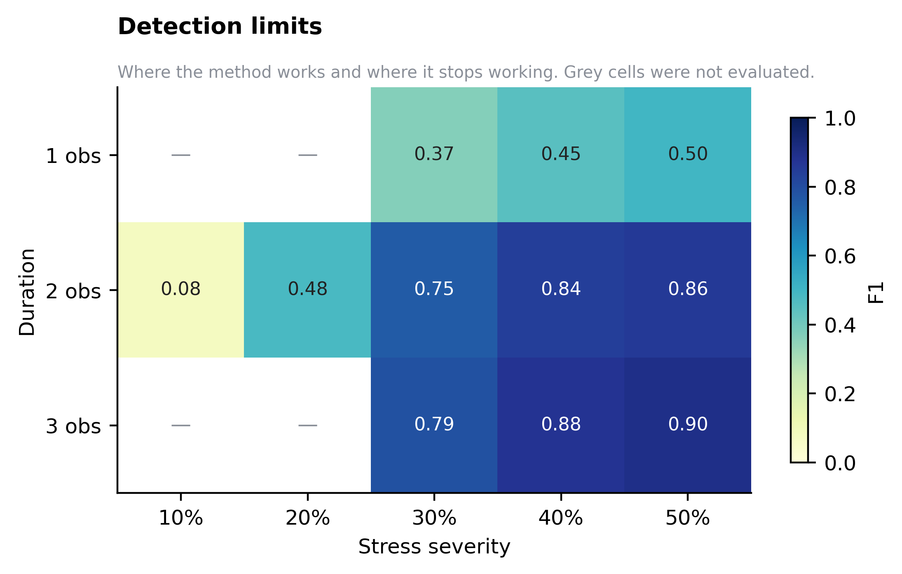

The weakest cell is 10% severity over 2 observation(s) at F1 0.077. Two failure regions are structural rather than incidental: a 10% depression of a field-mean index is comparable to the pass-to-pass variation the index shows anyway under changing illumination, and single-observation events are suppressed by design — the persistence rule cannot distinguish a one-pass excursion from a cloud artefact using temporal evidence alone.

### The operating point is not uniformly better — and this matters

| Severity | Duration | Study 2 F1 | This study F1 | Δ |
|---|---|---|---|---|
| 30% | 1 obs | 0.3002 | 0.3650 | +0.0648 |
| 40% | 1 obs | 0.3279 | 0.4515 | +0.1236 |
| 50% | 1 obs | 0.3465 | 0.4998 | +0.1533 |
| 10% | 2 obs | 0.2334 | 0.0774 | -0.1560 ⚠ |
| 20% | 2 obs | 0.5458 | 0.4819 | -0.0639 ⚠ |
| 30% | 2 obs | 0.6756 | 0.7549 | +0.0793 |
| 40% | 2 obs | 0.7181 | 0.8437 | +0.1256 |
| 50% | 2 obs | 0.7352 | 0.8591 | +0.1239 |
| 30% | 3 obs | 0.6419 | 0.7859 | +0.1440 |
| 40% | 3 obs | 0.6765 | 0.8773 | +0.2008 |
| 50% | 3 obs | 0.6905 | 0.8979 | +0.2074 |

**The strict operating point is tuned for the baseline scenario and pays for it on weak events.** It wins on 9 of 11 cells, often by more than 0.12 F1 — but it *loses* on the 2 weakest, worst at 10% severity where F1 falls 0.233 → 0.077.

The reason is direct: the EVT risk was chosen at 40% severity, so the threshold sits high enough that a 20%-severity dip barely clears it and recall collapses. Study 2's looser P85 cut caught more of those weak events, at the cost of everything else.

**This belongs in the paper as a stated trade-off, not a footnote.** If the deployment goal is early warning of *developing* stress, a looser threshold is the right choice and the numbers here are the wrong ones to quote. If the goal is reliable detection of established stress with few false alarms, this operating point is correct. The honest framing is that the risk parameter *q* is a dial the grower sets, and the paper should report the curve rather than a single point.

## 6 · Robustness to the stress signature

| Stress signature | Precision | Recall | F1 | PR-AUC | False alarms |
|---|---|---|---|---|---|
| Sudden drop | 0.8759±0.004 | 0.8138±0.006 | 0.8437±0.002 | 0.9039±0.004 | 350 |
| Gradual onset | 0.8719±0.011 | 0.4738±0.012 | 0.6139±0.012 | 0.7451±0.003 | 211 |
| Spectral shift | 0.8682±0.005 | 0.7568±0.016 | 0.8086±0.011 | 0.8535±0.002 | 349 |

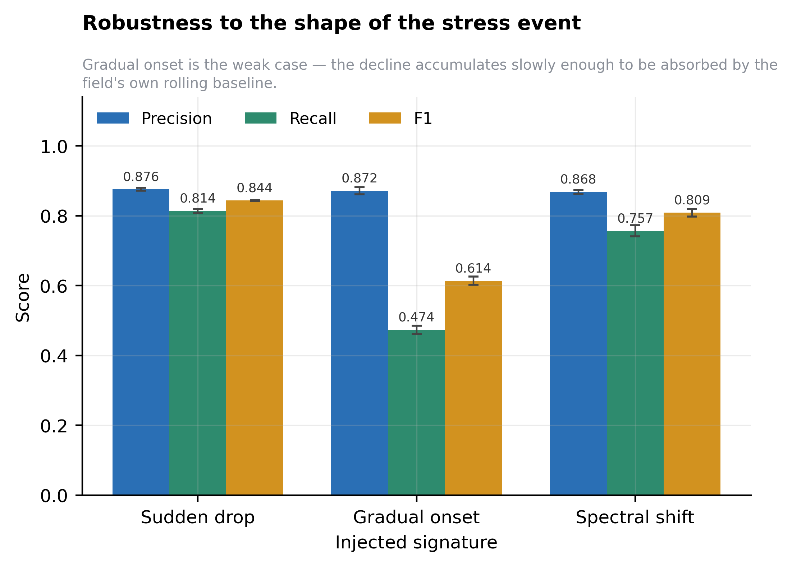

**Gradual onset** is the weak case (F1 0.614). The cause is the rolling baseline: a decline that accumulates slowly is partly absorbed into the rolling median the features are computed against, so the field's own reference drifts down with the stress and the residual stays small. This is agronomically the inconvenient failure, because progressive drought and spreading foliar disease — where early warning is worth most — are exactly slow-onset events.

## 7 · What held-out evaluation costs

| Protocol | Precision | Recall | F1 | PR-AUC | False alarms |
|---|---|---|---|---|---|
| Same fields (fitted on all, incl. test) | 0.8358±0.012 | 0.6233±0.008 | 0.7140±0.007 | 0.9450±0.003 | 372 |
| Held-out fields (fitted on a disjoint half) | 0.8252±0.015 | 0.5975±0.010 | 0.6930±0.009 | 0.9039±0.004 | 384 |

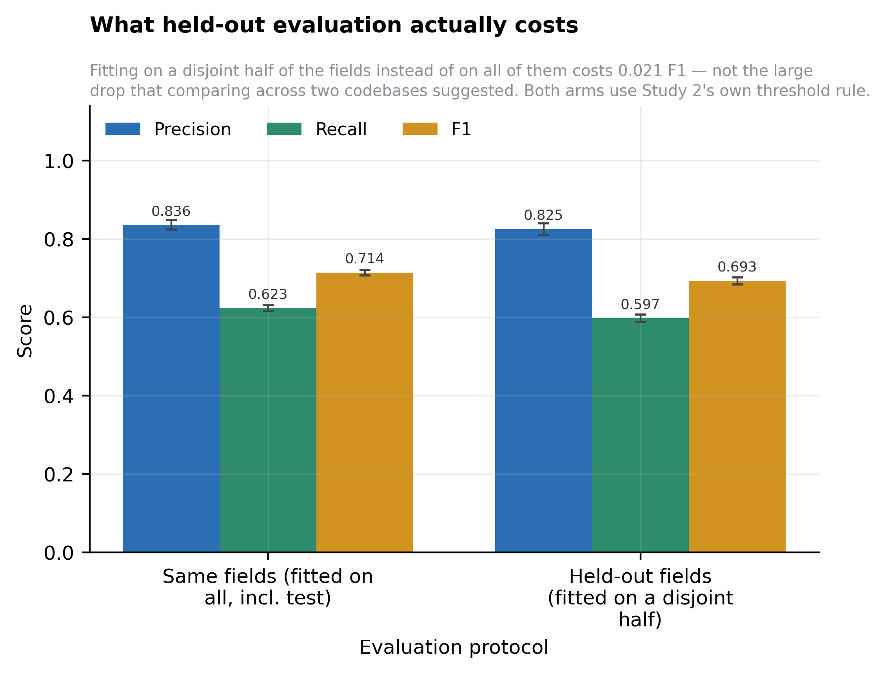

Fitting the detector on a disjoint half of the fields instead of on all of them costs **0.021 F1**. Everything else is held fixed.

**This corrects a claim in the earlier write-up.** `experiment3` reported F1 0.72 against 0.35 and read the gap as an evaluation-protocol effect. That comparison was made across two separate codebases which also differed in input representation, cloud screening, observation density and injection procedure. Measured properly, with only the protocol changing, the cost is small. Whatever separates those two numbers lives in the other differences, and should not be attributed to held-out evaluation.

## 8 · Ablations

### Feature set

| Feature set | Precision | Recall | F1 | PR-AUC | False alarms |
|---|---|---|---|---|---|
| Baseline (16 features) | 0.8759±0.004 | 0.8138±0.006 | 0.8437±0.002 | 0.9039±0.004 | 350 |
| + trajectory features (19) | 0.8134±0.006 | 0.7587±0.007 | 0.7851±0.003 | 0.8265±0.005 | 529 |

Adding lagged value, cumulative change and acceleration changes F1 by -0.0586. At a 10-day effective cadence a second difference is estimated across roughly three weeks of phenological change, so the derivative is dominated by growth dynamics rather than by stress. The baseline representation already carries first-order temporal context through its rolling statistics.

### LOF neighbourhood size

| k | Precision | Recall | F1 | PR-AUC | False alarms |
|---|---|---|---|---|---|
| 5 | 0.8855±0.007 | 0.8029±0.009 | 0.8421±0.004 | 0.9083±0.004 | 315 |
| 10 | 0.8759±0.004 | 0.8138±0.006 | 0.8437±0.002 | 0.9039±0.004 | 350 |
| 20 | 0.8706±0.007 | 0.8051±0.008 | 0.8365±0.002 | 0.8837±0.004 | 364 |
| 35 | 0.8695±0.004 | 0.7866±0.003 | 0.8259±0.002 | 0.8656±0.004 | 359 |
| 50 | 0.8673±0.007 | 0.7708±0.003 | 0.8162±0.004 | 0.8525±0.004 | 358 |
| 75 | 0.8642±0.007 | 0.7531±0.004 | 0.8048±0.003 | 0.8339±0.004 | 359 |

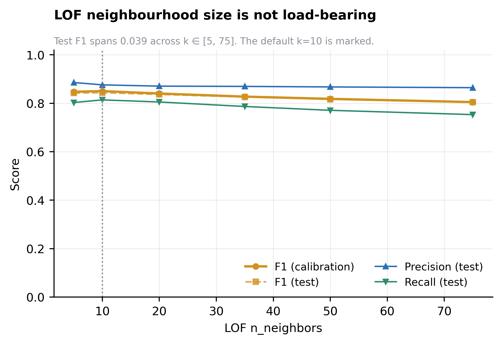

Test F1 spans 0.039 across k ∈ [5, 75]; the value chosen on the calibration split is k = 10. Study 2 fixed k = 10 and never swept it, listing that as an open limitation. It is now closed: the choice was not load-bearing.

## 9 · A worked example

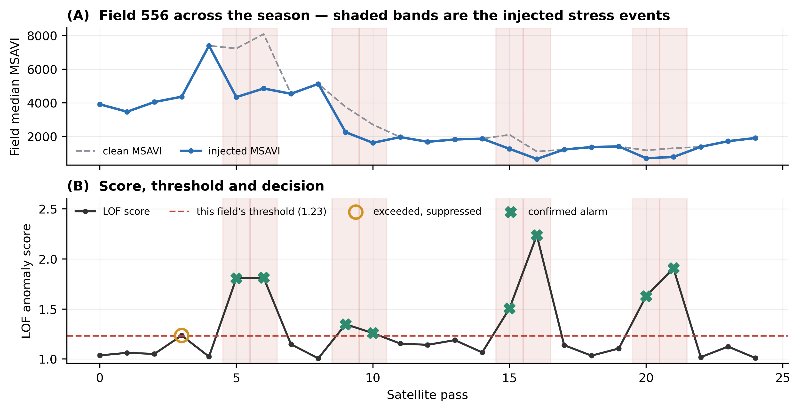

One held-out field, start to finish. Of 8 injected observations the detector confirmed 8 and missed 0, with 1 exceedance(s) suppressed by the persistence rule and 0 false alarms.

The suppressed point is the part worth showing. It crossed the field's own threshold, did not recur on the following pass, and was therefore discarded — the same mechanism that removes transient cloud artefacts also removes genuine one-pass events. Every recall figure in this report is net of exactly that suppression.

## 10 · The threshold-free view

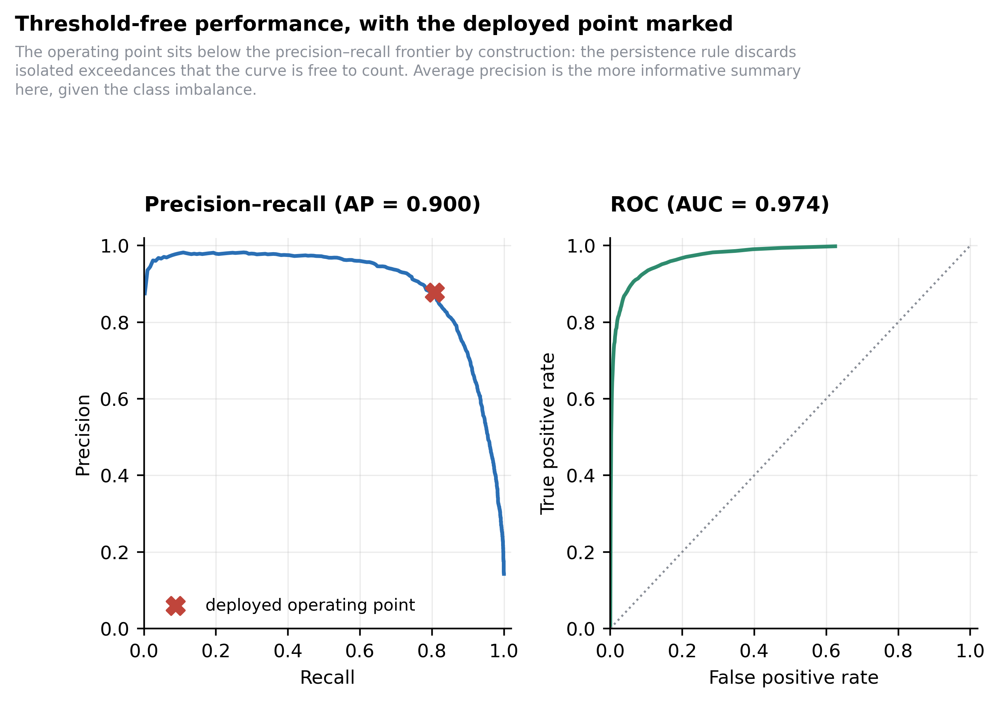

Every table above is measured at one operating point, which leaves a fair question open: is the ranking good, or was the cut simply lucky? Average precision is **0.900** and ROC-AUC **0.974**, both independent of any threshold. Average precision is the more informative of the two under this class imbalance.

The deployed point sits below the precision–recall frontier by construction, because the persistence rule discards isolated exceedances that the curve is free to count. That gap is the price of robustness to cloud artefacts, which the synthetic evaluation cannot reward.

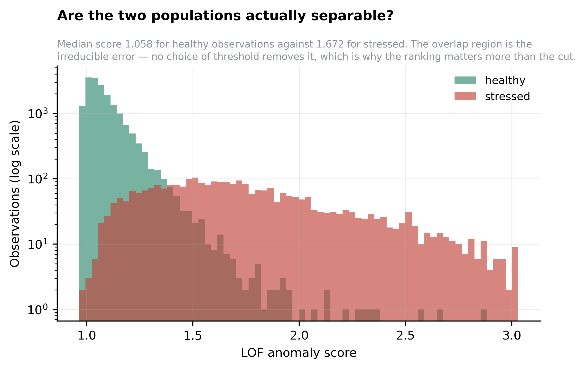

Healthy observations concentrate near the LOF floor (median 1.058); stressed observations spread substantially higher (median 1.672). The overlap between them is the irreducible error — no choice of threshold removes it, which is why the ranking matters more than the cut.

---

## What belongs in the paper

1. **Ensembling is harmful.** LOF 0.844 against 0.354 for the three-model hybrid. The negative result the project was built to avoid, and the most transferable thing in it.
2. **The operating point was leaving performance on the table.** F1 0.693 → 0.844 from calibrating the threshold on clean data, with the detector untouched.
3. **A principled threshold.** An EVT tail with a stated false-alarm risk, which also escapes the resolution limit of a 25-sample percentile.
4. **Honest scope.** Detection limits, the slow-onset weakness, what held-out evaluation does and does not cost — and the fact that the recommended operating point is *worse* than Study 2's on events below about 30% severity. That trade-off is a result, not an embarrassment: it says the risk parameter is a dial to be set from the cost of a missed event against the cost of a wasted field visit.

From `experiment3`, which is not superseded by this folder and should still be cited: multispectral input raises F1 by roughly 44% relative under its own protocol, and cross-year baselines fail because crop rotation gives a field a different normal from one season to the next. Its protocol claim should not be cited — section 7 above supersedes it.

## Limitations

- Synthetic injection remains the only ground truth. Absolute figures are an upper bound on operational performance; the comparisons between configurations are the reliable part.
- Clean calibration assumes a stress-free reference period per field. Available in retrospective seasonal analysis; an assumption for a real-time system, and `experiment3` showed that using the previous season as that reference is broken by crop rotation.
- One region, one season. The test split is 832 fields, so these figures carry more sampling noise than a whole-dataset number would.
- Field-level only. The detector emits one score per field per pass and does not localise within a field.
- Part of the improvement in section 1 is a fix for an evaluation-design flaw specific to a 15% injection rate. At a realistic stress prevalence the old rule would have been less damaged, so the gain should not be read as a pure detector improvement.

*Generated by `run_all.py` in 2035s. Every number read from `results.json`.*
